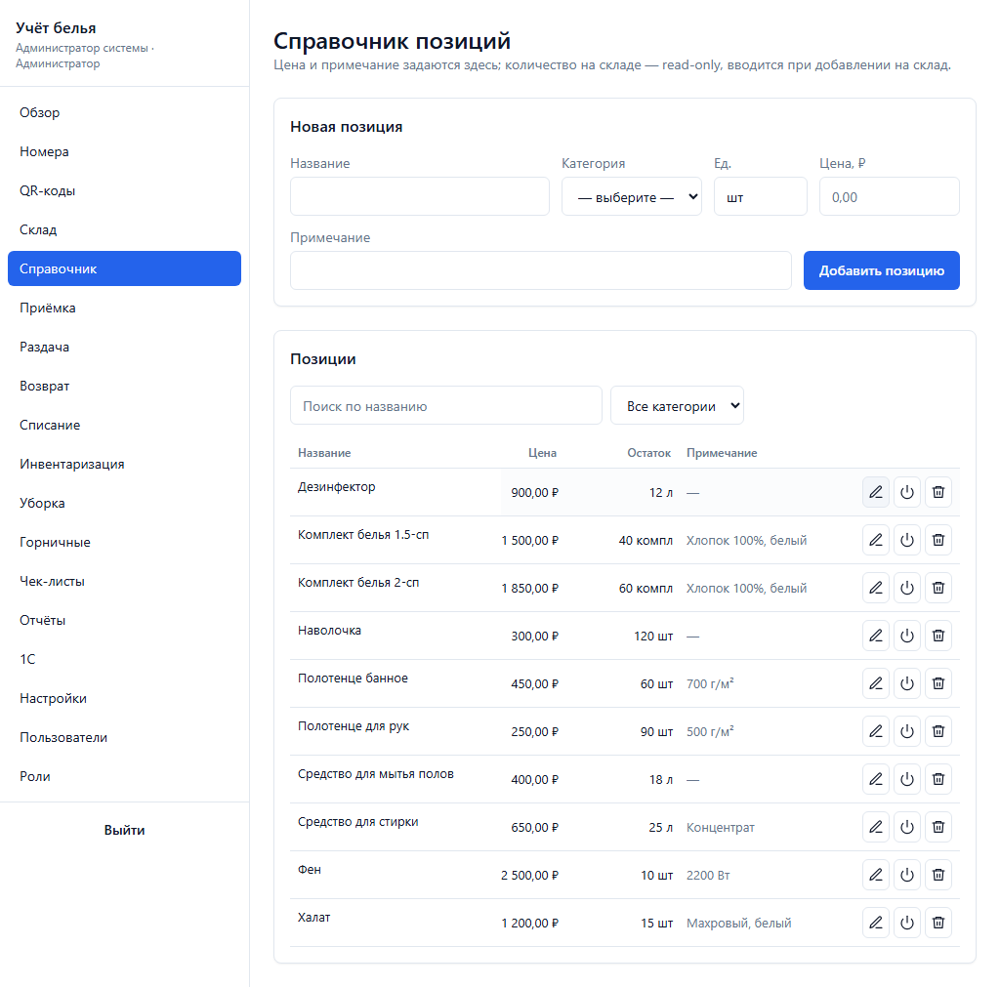
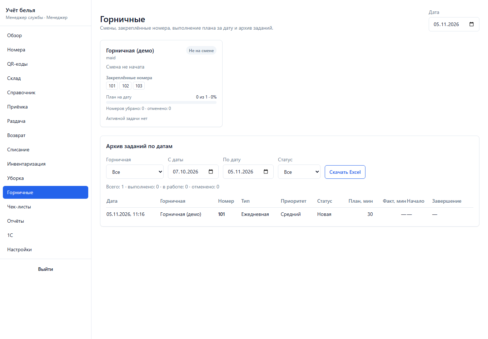
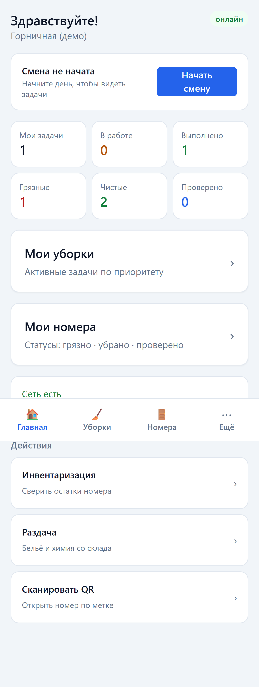

# Белая пристань — учёт постельного белья

**v2.2 (M1–M14 + этап 2 + 1С + гибкие номера)**

[](LICENSE)
[](https://github.com/AlexeyVN/hotel-linen-management/actions/workflows/ci.yml)

[](brand/README.md)

> **Идея и постановка:** Vlasevskii Aleksei Nikolaevich.
> **Разработчик:** DeepSeek Harness (AI-разработчик).
> **Репозиторий:** https://github.com/AlexeyVN/hotel-linen-management. CI — `.github/workflows/ci.yml`.

Веб-приложение для отеля **«Белая пристань»**: учёт постельного белья, инвентаря и химии, склад, приёмка, раздача по номерам, возврат, списание, инвентаризация с фото, QR-метки, выгрузки Excel, интеграция с 1С (опционально), а также хаускипинг — задачи на уборку, чек-листы, смены, раздел «Горничные» с планом и архивом; логотип отеля, печатные формы Excel, группы меню и акцентный цвет.

Реализация по ТЗ [v3.2](docs/hotel-linen-TZ-v3.2.md). Стек: Next.js 15 (App Router), TypeScript strict, React 19, Tailwind, tRPC v11, Prisma 6 + SQLite, next-auth v4, PWA (manifest + service worker), Playwright. M1 — фундамент и права, M2 — склад и операции, M3 — инвентаризация и фото, M4 — PWA и офлайн-очередь, M5 — коннектор 1С/отчёты/эксплуатация; этап 2 — QR и Excel; M6 — хаускипинг; M7 — чек-листы и мобильный интерфейс; M8 — справочник, цена, дата, оценка; M9 — «Горничные»; M10 — адаптивный справочник; M11 — общий компонент таблиц; M12 — QR-маршруты и хранение меток; M13 — логотип и печатные формы Excel; M14 — навигация, цвет темы, редактирование пользователей; post-M14 — статусы 1С, гибкие номера и меню.

## Что уже работает

| Модуль | Состояние |
|---|---|
| Схема БД (Prisma + SQLite), миграции, идемпотентный seed | готово |
| Вход по логину/паролю (next-auth v4, JWT, 8 ч), блокировка после 10 ошибок | готово |
| Роли и права: 20 прав, 3 пресета, редактирование матрицы прав, защита ADMIN от самоблокировки | готово |
| «Свои номера» горничной — фильтр в данных, не в UI | готово |
| Номера: список, фильтры по этажу/типу, поиск, добавление номера, типы комнат (добавление/переименование/вкл-выкл), деактивация | готово |
| Гибкие номера: этаж числом или свободным названием, тип из справочника или новый тип, редактирование номера/этажа/типа; управление только ADMIN | готово |
| Склад: остатки по категориям | готово |
| Справочник позиций: цена, примечание, остаток read-only, добавление/удаление с защитой | готово |
| Склад: цена, стоимость, дата последнего поступления; добавление из справочника с датой | готово |
| Удаление номеров (только без истории); позиций (только без остатка/истории) | готово |
| Настройка «Показывать даты в документах» | готово |
| Инвентаризация с ценой, стоимостью расхождений и датой поступления | готово |
| Отчёты: остатки (цена/стоимость/дата), движения по дате документа (цена/сумма), дефицит (стоимость), «позиции без цены» | готово |
| Excel: цена/стоимость/дата, лист «Без цены» | готово |
| 1С DTO: `documentDate`, `unitPriceKopecks`, `totalKopecks` | готово (поля необязательные) |
| 1С: обмен статусами номеров — webhook в систему, SetRoomStatus из очереди, дедуп и защита от устаревших событий | готово (контракт настраивается, mock) |
| Раздел «Горничные»: статусы, смены, закреплённые номера, план на дату | готово |
| Архив заданий горничных по датам + Excel (`report=maid-tasks`) | готово |
| Типы уборки: Ежедневная / По требованию / Генеральная (CHECKOUT удалён миграцией) | готово |
| Адаптивная таблица справочника: прокрутка внутри контейнера, скрытие колонок на телефоне, иконки действий, 13→14 px | готово |
| Общий компонент таблиц `DataTable` для склада, отчётов, горничных, уборки и номеров | готово |
| QR-маршруты `/r/<номер>` и `/i/<код>`: вход с callback, переход по роли, 404/деактивация | готово |
| Сохранение QR в `QrCode` + `storage/qr`, одна активная метка, печать из сохранённых | готово |
| Удаление QR вместе с позицией/номером; при списании остатка метка сохраняется | готово |
| Логотип отеля: загрузка ADMIN, canvas→PNG ≤1600, прозрачность, отображение на входе и в админке | готово |
| Печатные формы Excel: логотип, отель, дата, «Составил», ответственный, место для подписи, A4 | готово |
| Навигация: группы «Склад», «Документы», «Уборка», «Настройки»; активная группа раскрыта | готово |
| Акцентный цвет: 8 палитр + HEX, контраст ≥4.5:1, применяется во всём интерфейсе | готово |
| Пользователи: редактирование ФИО и логина с проверкой уникальности | готово |
| Роли: все 20 прав с русскими подписями, без технических кодов в чекбоксах | готово |
| Бренд «Белая пристань»: знак, lockup, PWA-иконки, название в приложении и Excel | готово |
| Приёмка: многострочная, атомарная транзакция | готово |
| Раздача в номер: проверка остатка, отказ при превышении | готово |
| Возврат из номера | готово |
| Списание: склад или номер; причина обязательна — из справочника (порча, износ, загрязнение, утеря, бой) или свободным текстом | готово |
| Идемпотентность операций по `clientOpId` (повтор не удваивает остаток) | готово |
| Очередь экспорта в 1С (`OutboxEntry`, PENDING) для каждой операции | готово (отправка — M5) |
| Пользователи: создание, смена роли, деактивация, сброс пароля, назначение номеров горничной | готово |
| Инвентаризация номера: черновик/применение, учёт против факта, расхождения с корректировкой остатка | готово |
| Фотофиксация: загрузка JPEG/PNG/WebP до 5 МБ с проверкой сигнатуры, отдача только авторизованным | готово |
| Доступ горничной к инвентаризации только назначенных номеров | готово |
| PWA: manifest, иконки, свой service worker (офлайн-оболочка), кнопка обновления | готово |
| Динамический бренд: title вкладки, description, Apple title и webmanifest берутся из названия отеля | готово |
| Офлайн-очередь мутаций в IndexedDB: раздача, сохранение черновика, применение инвентаризации; авто-досыл и ручной разбор конфликтов | готово |
| Мобильные экраны: главная, инвентаризация (камера), раздача; TabBar с крупными кнопками | готово |
| UI-проверки Playwright: скриншоты, PWA, офлайн-сценарий | готово (Chromium локально в проекте) |
| Коннектор 1С: контракт ErpAdapter, заглушка и HTTP-адаптер, шифрование пароля AES-256-GCM, проверка соединения | готово |
| Синхронизация номенклатуры из 1С и отправка операций через outbox (ретраи, экспоненциальная задержка, ручной досыл) | готово |
| Фоновый воркер 1С + внешний триггер `POST /api/integration/worker` | готово |
| Отчёты: остатки склада, движения за период, дефицит по минимальным остаткам | готово |
| QR-метки: генерация для номеров и позиций, три формата нагрузки (URL/JSON/текст), два формата файла (PNG/SVG), печать листа | готово |
| Сканирование QR: камера (jsQR) + ручной ввод, приём всех форматов, переход к инвентаризации/раздаче | готово |
| Excel-выгрузка отчётов: остатки, движения, дефицит (кнопка в отчётах) | готово |
| Хаускипинг: статусы номеров, задачи на уборку с приоритетами, смены горничных, офлайн-переходы статусов | готово |
| Отчёт по уборке: задачи/время по горничным + Excel (`report=tasks`) | готово |
| Чек-листы уборки: шаблоны с пунктами, обязательные фото, запрет завершения без чек-листа | готово |
| Мобильный интерфейс по образцу TL Extranet: дашборд, «Уборки»/«Номера», детали задачи, комментарии, отказ от уборки | готово |
| Бэкап и восстановление БД: `deploy/backup.cmd`, `deploy/restore.cmd` | готово |
| tRPC-роутеры: auth, rooms, items, operations, audit, integration, users, roles | готово |
| Логи pino с ротацией, rate limit, ошибки домена → человеческие сообщения | готово |
| Тесты `node --test` | 88/88 |

## Быстрый старт

Требования: Node.js 24+, npm. SQLite отдельно не нужен.

**Для Windows + Open Server Panel:** запустите от имени администратора `install.cmd` в корне проекта. Он по шагам спросит пути и адрес, установит зависимости, применит миграции, соберёт проект и настроит статические файлы OSPanel. Подробно — [docs/INSTALL-OPEN-SERVER.md](docs/INSTALL-OPEN-SERVER.md).

```bash
cd hotel-linen-management/app

npm ci                              # зависимости из package-lock.json
cp .env.example .env                # Windows: copy .env.example .env
# заполнить NEXTAUTH_SECRET: node -e "console.log(require('crypto').randomBytes(32).toString('base64url'))"

npx prisma generate
npx prisma migrate deploy           # схема + data-миграции
npx prisma db seed                  # демо-данные

npm run dev                         # http://localhost:3000
```

Проверки:

```bash
npm test                            # node --test, 88 тестов
npm run build                       # production-сборка
```

Запуск production: `npm run build && npm start` (по умолчанию `0.0.0.0:3000`).

Развёртывание: [docs/DEPLOYMENT.md](docs/DEPLOYMENT.md) (Linux/Windows, прокси, HTTPS, OSPanel). Для новичка — [пошаговая установка на Open Server](docs/INSTALL-OPEN-SERVER.md). Эксплуатация: [docs/OPERATIONS.md](docs/OPERATIONS.md). Настройки: [docs/CONFIGURATION.md](docs/CONFIGURATION.md).

## Тестовые пользователи (seed)

| Логин | Пароль | Роль |
|---|---|---|
| `admin` | `Admin123!` | Администратор |
| `manager` | `Manager123!` | Менеджер |
| `maid` | `Maid123!` | Горничная (номера 101, 102, 103) |

Пароли демонстрационные — сменить при первом реальном входе.

## Правила операций

1. Остатки меняются только транзакцией: операция, строки, склад/номер, запись в очередь 1С — всё или ничего.
2. Отрицательный остаток невозможен: раздача/списание больше остатка отклоняются с текстом «Недостаточно на складе / в номере».
3. Повтор с тем же `clientOpId` возвращает исходную операцию (`idempotent: true`), остаток не меняется.
4. Списание без причины не проводится; причина сохраняется в `Operation.reason`.
5. Права проверяются на сервере: горничной списание и склад недоступны (403).
6. Администратор не может деактивировать себя; у роли ADMIN нельзя снять `users.manage`/`roles.manage`.
7. Инвентаризация: черновик можно сохранять и продолжать; применение создаёт операцию AUDIT с корректировкой остатка номера; после применения правки запрещены (исправление — новой инвентаризацией).
8. Фото необязательно: загрузка доступна в черновике, тип проверяется по сигнатуре файла, файлы лежат вне `public` и отдаются только через проверку прав.
9. Офлайн: раздача и работа с черновиком инвентаризации ставятся в очередь IndexedDB и отправляются при появлении сети; `clientOpId` гарантирует отсутствие дублей. Конфликт (нет остатка, номер уже проведён) не ретраится — показывается оператору.
10. Горничная работает только со своими номерами: это проверяется на сервере и для инвентаризации, и для раздачи/возврата.
11. Фото в офлайне не загружается (нужна сеть) — ограничение показано в интерфейсе.
12. 1С — необязательный канал: при недоступности 1С операции учитываются локально, очередь растёт; отправка идемпотентна (`clientOpId`), пароль хранится зашифрованным и наружу не отдаётся. Отключение интеграции останавливает обмен, но не учёт.
13. Протокол 1С: `GET /hs/hotel/ping`, `GET /hs/hotel/items`, `POST /hs/hotel/operations` (Basic-авторизация). Реальный эндпоинт заказчика подменяется базовым URL в настройках.
14. QR: одна и та же метка читается в любом из трёх форматов; тип объекта определяется по содержимому. Голый код (например `101`) разрешается сначала как номер, затем как позиция. Метки позиций используют `externalId`, если он задан, иначе внутренний id.
15. Excel: выгрузка идёт через авторизованный route handler с проверкой права `reports.view`; файл формируется ExcelJS, листы названы по отчёту.
16. Уборка: создание задачи помечает номер грязным, завершение — чистым (кроме «в ремонте»); горничная меняет только свои задачи, менеджер/админ — через `cleaning.manage`.
17. Переходы статусов задач проверяются на сервере (`NEW → IN_PROGRESS → DONE`, отмена из активных); повтор того же статуса идемпотентен, офлайн-статусы досылаются ровно один раз.
18. Чек-лист: задачу нельзя завершить, пока все пункты не отмечены; при обязательном фото пункт закрыт только после загрузки фото. Сервер отвечает «Чек-лист не завершён: отмечено X из Y…».
19. Мобильный интерфейс горничной повторяет логику TL Extranet: дашборд со статусами, «Уборки» с фильтрами, «Номера» со статусами, детали задачи с чек-листом и действиями.
20. Деньги хранятся в копейках (`Int`), в UI — рубли с двумя знаками; цена задаётся только в справочнике.
21. Приёмка принимает дату поступления (`documentDate`); `lastReceiptAt` обновляется как максимум из дат, чтобы обратная датировка не «омолаживала» позицию.
22. Удаление физическое только без истории: номер — без остатков/операций/инвентаризаций/задач; позиция — без остатка/операций/инвентаризаций. Иначе — деактивация.
23. Оценка: `стоимость = количество × текущая цена справочника`; инвентаризация и отчёты используют текущую цену. Партии/FIFO не ведутся — историческая стоимость пересчитывается при изменении цены (зафиксировано в ТЗ §17).
24. Движения в отчётах фильтруются и отображаются по `documentDate`, а не по дате создания записи.
25. План горничной за дату = задачи, созданные в эту дату и назначенные ей, кроме `CANCELLED`; процент = `DONE / план`; 0 задач → «—».
26. Типы уборки: `DAILY`, `ON_DEMAND`, `GENERAL`; `CHECKOUT` удалён, старые задачи переведены в `ON_DEMAND` data-миграцией.
27. Таблицы с данными прокручиваются внутри своего контейнера (`overflow-x-auto` + `contain: paint`), а не растягивают страницу; числовые колонки — `whitespace-nowrap`/`tabular-nums`, текст — не мельче 12 px.
28. Адаптивность таблицы справочника: 13 px до 1280 px, 14 px на десктопе; на <768 px скрываются «Категория», «Ед.», «Примечание» (примечание — под названием).
29. QR-маршруты `/r/<code>` и `/i/<code>` требуют входа; callbackUrl принимается только как внутренний путь.
30. Метка хранится в `QrCode` и `storage/qr`, одна активная на объект; перегенерация заменяет файл и запись. При смене номера/externalId/базового URL метка помечается «устарела» и перегенерируется вручную.
31. Удаление QR — только при удалении позиции/номера из справочника; `WRITE_OFF` и деактивация метку не удаляют.
32. Логотип загружает только ADMIN (`settings.branding`); клиент уменьшает изображение до 1600 px и сохраняет PNG с альфа-каналом; сервер принимает только PNG ≤2 МБ.
33. Excel-выгрузки используют единую печатную форму: логотип, отель, дата, «Составил» (текущий пользователь), ответственный из настроек, линии подписи и даты.
34. Логотип хранится в `storage/branding/logo.png`, отдаётся публично `/api/branding/logo`; при отсутствии — текстовая шапка.
35. Меню: группы «Склад» (Справочник, Склад), «Документы» (Приёмка, Раздача, Возврат, Списание, Инвентаризация, QR), «Уборка», «Настройки» (Общие настройки, Номера и типы комнат, Пользователи, Роли, Интеграция 1С); группы скрываются без прав.
36. Акцентный цвет — `ui.accentColor`: 8 пресетов + HEX, контраст с белым ≥4.5:1; применяется через CSS-переменную `--primary`.
37. ADMIN меняет ФИО и логин пользователей; логин уникален, смена своего логина не завершает текущую сессию.

## Структура

```
brand/                      знак, lockup, SVG/PNG, PWA-иконки
install.cmd                 интерактивная установка Windows/OSPanel
app/
  prisma/                   схема, миграции, seed
  src/lib/domain/           чистые функции: stock, writeoff, audit, reports, qr, cleaning, checklist, maids
  src/lib/offline/          IndexedDB-очередь, политика ретраев, кэш
  src/lib/photos.ts         сигнатуры изображений, хранение вне public
  src/server/erp/           контракт, адаптеры stub/1С, секреты, синхронизация, воркер
  src/server/reports/       книги Excel
  src/server/services/      проведение операций в транзакции
  src/server/trpc/          роутеры и проверки прав
  src/app/admin/            админка: номера, QR, склад, справочник, операции, инвентаризация, отчёты, горничные, 1С, настройки
  src/app/m/                мобильные экраны горничной: дашборд, уборки, номера, инвентаризация, раздача, сканер
  src/app/r/, src/app/i/    QR-маршруты номеров и позиций (вход → переход по роли)
  src/app/api/              фото, Excel, QR-файлы, внешний триггер воркера 1С
  storage/qr/               сохранённые QR-метки (вне public, не коммитятся)
  storage/branding/         логотип отеля PNG (вне public, не коммитится)
  src/components/           формы, таблицы (DataTable), QR-сканер, чек-листы, мобильные экраны
  public/                   sw.js, icons; webmanifest — динамический /api/manifest
  scripts/                  make-icons, ui-*, mock-1c, deploy-check
  tests/                    node --test (88)
deploy/                     start.cmd, backup.cmd, restore.cmd, install.ps1, Windows-заметки
docs/                       ТЗ, планы, скриншоты, DEPLOYMENT/OPERATIONS/CONFIGURATION/GITHUB
.github/workflows/ci.yml    CI: install → migrate → test → build
.github/dependabot.yml      обновления npm и GitHub Actions
```

## Скриншоты

| Админка | Горничные | Мобильный кабинет |
|---|---|---|
|  |  |  |

Ещё: [склад](docs/screenshots/warehouse.png), [инвентаризация с оценкой](docs/screenshots/audit.png), [QR-метка](docs/screenshots/qr.png), [логотип на входе](docs/screenshots/hotel-login.png), [бренд в админке](docs/screenshots/hotel-admin.png), [настройки брендинга](docs/screenshots/branding-settings.png), [цвет на входе](docs/screenshots/accent-login.png), [мобильное меню](docs/screenshots/nav-mobile.png), [пользователи](docs/screenshots/users.png), [роли](docs/screenshots/roles.png), [статусы 1С](docs/screenshots/1c-room-status.png), [гибкие номера](docs/screenshots/rooms-custom-fields.png).

## Документация

- ТЗ: [docs/hotel-linen-TZ-v3.2.md](docs/hotel-linen-TZ-v3.2.md)
- Развёртывание: [docs/DEPLOYMENT.md](docs/DEPLOYMENT.md)
- Установка для новичка на Open Server Panel: [docs/INSTALL-OPEN-SERVER.md](docs/INSTALL-OPEN-SERVER.md)
- Эксплуатация: [docs/OPERATIONS.md](docs/OPERATIONS.md)
- Настройки и права: [docs/CONFIGURATION.md](docs/CONFIGURATION.md)
- История изменений: [CHANGELOG.md](CHANGELOG.md), безопасность: [SECURITY.md](SECURITY.md)
- Планы этапов: [справочник/цена](docs/plan-catalog-rooms-2026-11-05.md), [горничные](docs/plan-maids-2026-11-05.md), [адаптивные таблицы](docs/plan-catalog-table-2026-11-05.md), [QR-маршруты и хранение](docs/plan-qr-routes-persist-2026-11-05.md), [сброс QR в UI](docs/plan-qr-ui-reset-2026-11-05.md), [логотип и Excel](docs/plan-branding-excel-2026-11-05.md), [навигация и пользователи](docs/plan-ui-nav-users-2026-11-05.md), [перестройка страницы пользователей](docs/plan-users-ui-2026-11-05.md), [русские подписи прав](docs/plan-roles-labels-2026-11-05.md), [статусы номеров 1С](docs/plan-1c-room-status-2026-11-05.md), [гибкие номера](docs/plan-rooms-custom-fields-2026-11-17.md)
- Будущие решения: [FutureToDo](FutureToDo.md) — многоязычность, валюта, открытые вопросы
- Бренд: [brand/README.md](brand/README.md), [логотип](brand/logo-lockup.png)
- Анализ рынка: [docs/analysis-housekeeping-market-2026-11-05.md](docs/analysis-housekeeping-market-2026-11-05.md)
- Публикация на GitHub: [docs/GITHUB.md](docs/GITHUB.md)
- Карта документации: [docs/README.md](docs/README.md)
- Участие в разработке: [CONTRIBUTING.md](CONTRIBUTING.md)

## Лицензия

Проект распространяется по **Apache License, Version 2.0**.
Copyright 2026 **Vlasevskii Aleksei Nikolaevich**. Идея и постановка — Vlasevskii Aleksei Nikolaevich.
Разработчик — **DeepSeek Harness**.

- [LICENSE](LICENSE) — полный текст лицензии.
- [NOTICE](NOTICE) — уведомление об авторстве.

При распространении сохраняйте `LICENSE` и `NOTICE`; изменённые файлы отмечайте. Сторонние зависимости имеют собственные лицензии (см. `package-lock.json`).

## Известные ограничения

- `NEXTAUTH_URL` в `.env` для локального запуска — `http://localhost:3000`; на домене укажите свой URL (`https://hotel` в текущем развёртывании OSPanel).
- Установка PWA на телефоне требует HTTPS (secure context). На `http://LAN-IP` service worker не регистрируется; в OSPanel настроен HTTPS-домен.
- Push-уведомления, KPI, ретеншен фото/операций — вне объёма.
- PMS у отеля нет: задачи на уборку создаются вручную; автосоздание по заездам/выездам не требуется.
- Иерархия подпунктов чек-листа, автораспределение задач и нормативы времени — вне объёма.
- Реальный протокол 1С Отель не подтверждён: адаптер проверен на моке; при другом формате меняется `src/server/erp/adapters/onec.ts`.
- Смена названия отеля обновляет title/description/Apple title и `/api/manifest` без пересборки; уже установленное PWA может сохранить старое имя до обновления/переустановки приложения.
- Партии/FIFO не ведутся: историческая стоимость пересчитывается по текущей цене (ТЗ §17.3).
- QR: одна активная метка на объект; при смене номера/externalId/домена метка «устаревает» и перегенерируется вручную. Списание остатка (`WRITE_OFF`) не удаляет позицию и QR.
- Логотип: только PNG (JPEG/WebP преобразуются в браузере), один активный файл, загрузка только ADMIN; логотип в Excel вставляется как PNG.
- 1С: точный контракт Housekeeping/SetRoomStatus и наличие webhooks не подтверждены публичной документацией; путь/метод настраиваются, реальный контур нужно проверить с внедренцем.
- На телефоне таблицы прокручиваются внутри карточки (карточная раскладка строк — следующий этап).

## Промежуточные сохранения (чекпоинты)

Снапшот состояния проекта — `scripts\checkpoint.cmd` из корня `Coding_workspace` (R24):

```cmd
scripts\checkpoint.cmd -Project hotel-linen-management -Stage M2
scripts\restore.cmd -Checkpoint _checkpoints\hotel-linen-management-<штамп> -Target <новая папка> -WithDb
```

Что попадает в снапшот: исходники (`app/`, `deploy/`, README), миграции Prisma, БД через `VACUUM INTO`, `MANIFEST.json` с SHA-256 каждого файла, `STATE.md` с планом продолжения.
Не попадает: `node_modules`, `.next`, `.npm-cache`, логи, `.tmp`, `backups`, `.env` (секреты).

Последний снапшот — самый свежий каталог `_checkpoints\hotel-linen-management-*` в корне `Coding_workspace`; рядом `STATE.md` с этапом и планом продолжения.
Восстановление проверялось на каждом этапе: SHA-256 всех файлов совпадают, `integrity_check` базы — `ok`; для M1–M2 в восстановленной копии прогонялись `npm test` и `npm run build`.

## Проверено фактически (2026-11-04, M1–M2)

Историческая проверка ранних этапов; актуальные прогоны M14 — ниже.

- `npm run build` — 20 маршрутов, типы проверены.
- `npm test` — 24 теста, 24 pass.
- Seed — `{"users":3,"roles":3,"permissions":14,"rooms":10,"roomTypes":3,"items":10,"minStocks":15,"writeOffReasons":5}`; повторный запуск без дублей.
- Приёмка +5: склад 60 → 65. Повтор с тем же `clientOpId`: `idempotent: true`, остаток 65.
- Раздача 2 в 101: склад 63, в номере 2. Раздача 9999: «Недостаточно на складе», остаток не изменился.
- Возврат 1: номер 1, склад 64.
- Списание без причины: отказ с текстом «Причина списания обязательна». С причиной «Износ»: склад 61, `Operation.reason = "Износ"`. Свободный текст: `"порвано при стирке"`.
- Горничная: списание 403 «Нет права writeoff.create», `users.list` 403.
- Номера: тип DELUXE создан, номер 105 добавлен; деактивация типа с активным номером отклонена; после деактивации номера — тип деактивирован.
- Пользователи: `maid2` создана, до назначения номеров видела 0, после назначения 101/102 — 2. Смена роли на MANAGER доступа к `users.list` не дала. Деактивированная не входит, сброс пароля вернул доступ.
- Роли: снятие `reports.view` у MANAGER применено (0 в БД, 11 прав в API), возврат восстановил; деактивация самого себя отклонена.
### M3 — инвентаризация и фото (2026-11-05)

- `npm test` — 28 тестов, 28 pass; `npm run build` — 24 маршрута.
- Раздача 2 комплектов в 101 → учёт 2. Старт инвентаризации: 10 строк, статус DRAFT; повторный старт вернул тот же черновик (`reused: true`).
- Черновик: бельё факт 1, халат факт 3 — сохранено (`saved: 10`).
- Фото PNG загружено; авторизованный GET — 200 `image/png`, анонимный — 401; текст вместо картинки — 415; файл 6 МБ — 413.
- Применение: расхождений 2 (излишек 3, недостача −1); остатки номера 101 после корректировки — бельё 1, халат 3; создана операция AUDIT; сессия APPLIED.
- Правки после применения: `saveDraft` — отказ, загрузка фото — 409.
- Горничная: свой номер 101 — разрешено, чужой 104 — 403.
### M4 — PWA, офлайн-очередь, мобильные экраны (2026-11-05)

- `npm test` — 34 теста, 34 pass; `npm run build` — 28 маршрутов.
- Playwright (Chromium 156.0.8078.4, установлен локально в `.playwright-browsers`) — 11 проверок, 0 ошибок страницы:
  вход администратора, 5 разделов админки, старт и сохранение черновика инвентаризации из UI;
  вход горничной, service worker активен, manifest подключён, TabBar из 3 вкладок;
  экраны `/m/audit` и `/m/distribute` отрисовываются.
- Офлайн-сценарий: раздача «Дезинфектор × 1» в 101 при выключенной сети → запись в очереди, оболочка `/m` открылась из кеша SW, панель показала «ждёт отправки».
- После включения сети очередь досылается автоматически; остаток склада 12 → 11 (**ровно на 1, дубля нет**), в БД одна операция с `clientOpId LIKE 'm4-distribute-%'`, в номере 101 — 1 единица.
- Черновик инвентаризации из UI и очередь 1С (`OutboxEntry PENDING`) созданы штатно; скриншоты — `app/screenshots/` (14 файлов).
- БД возвращена к чистому seed; порт 3000 свободен. Повторный прогон на чистой БД — те же 11 проверок зелёные.

Запуск проверки UI (сервер уже поднят):

```cmd
node scripts\make-icons.mjs      :: перегенерация иконок PWA
node scripts\ui-check.mjs        :: скриншоты + офлайн-сценарий, exit code 0/1
```

### M5 — коннектор 1С, отчёты, эксплуатация (2026-11-05)

- `npm test` — 43 теста, 43 pass (включая шифрование пароля, парсинг ответа 1С, расчёт дефицита); `npm run build` — 29 маршрутов.
- Коннектор проверен на моке HTTP-сервиса 1С (`scripts/mock-1c.mjs`, порт 3100):
  сохранение настроек (пароль в БД — `v1:…`, 61 символ, шифротекст), `ping` → «1С ответила»,
  синхронизация номенклатуры → создано 2 позиции с `externalId` `1C-201`/`1C-202`.
- Отправка очереди: `RECEIVE` и `DISTRIBUTE` ушли в 1С, `OutboxEntry` → `SENT`, `externalRef` `1C-OP-1/2`;
  мок получил оба DTO с `externalId` и номером `101`.
- Сбой 1С: два раза `fetch failed`, записи остались `PENDING` с `attempts=1`, ошибка записана в настройки;
  после подъёма мока повторная отправка — `sent: 2`, `attempts=2`, `SENT` (ретраи работают).
- Отключение интеграции: `pushNow` → «Интеграция выключена», приёмка при этом проводится локально (операция создана, outbox ждёт).
- UI (Playwright, `scripts/ui-m5.mjs`): кнопки «Проверить соединение» и «Загрузить номенклатуру» работают из интерфейса, 0 ошибок страницы; отчёты «Остатки склада» (10 позиций) и «Дефицит в номерах» (49 строк) отрисовываются.
- Скриншоты: `15-admin-integration.png`, `16-admin-report-stock.png`, `16-admin-report-low.png`.
- `deploy/restore.cmd`: бэкап → восстановление → `PRAGMA integrity_check = ok`, предыдущая БД сохранена в `backups\pre-restore-*.db`.
- БД возвращена к чистому seed (0 операций, 0 outbox, интеграция выключена), тестовые бэкапы и `.tmp` удалены, порт 3000 свободен.

### Этап 2 — QR-метки и Excel-выгрузки (2026-11-05)

- `npm test` — 56 тестов, 56 pass (добавлены разбор/сборка QR во всех форматах и проверка книг Excel чтением обратно); `npm run build` — 32 маршрута.
- QR-генерация через API: 3 формата нагрузки × 2 формата файла — все 6 комбинаций отдают payload и изображение:
  `url` → `http://localhost:3000/r/101`, `json` → `{"v":1,"type":"room","code":"101",...}`, `text` → `HOTEL:ROOM:101`; PNG — data URL, SVG — разметка.
- Проверка кодов: `/r/101`, JSON, `HOTEL:ROOM:101`, голый `101`, URL с `?room=101` → «Номер 101 · Стандарт»; JSON позиции → «Комплект белья 2-сп»; неизвестный `HOTEL:ROOM:999` → `NOT_FOUND`.
- Декодирование: PNG, сгенерированный библиотекой, растеризован в браузере и распознан `jsQR` обратно в исходный payload — тот же путь, что использует сканер.
- Playwright (`scripts/ui-stage2.mjs`): генерация метки из админки, печать листа (10 меток), скачивание Excel из отчёта и открытие книги — лист «Движения», 2 строки; сканер на телефоне принимает голый код, текст и JSON подряд; 0 ошибок страницы.
- Excel: `stock` 7,0 КБ, `low` 7,9 КБ, `movements` 6,9 КБ, подпись `PK` — валидные xlsx.
- Скриншоты: `17-admin-qr-generate.png`, `18-admin-qr-print.png`, `19-admin-reports-excel.png`, `20-mobile-qr-scan.png`.
- БД возвращена к чистому seed (0 операций), `.tmp` очищен, порт 3000 свободен.

### M6 — хаускипинг: задачи и статусы номеров (2026-11-05)

Основание: [анализ практик Bnovo/TeamJet и ME Hotel](docs/analysis-housekeeping-market-2026-11-05.md). Чек-листы добавлены в M7 (ТЗ v2.5+).

- `npm test` — 64 теста, 64 pass (добавлены переходы статусов, приоритеты/сортировка, сводка уборки, строки Excel по задачам); `npm run build` — 34 маршрута.
- Права: 16 (добавлены `cleaning.manage`, `cleaning.execute`); горничная получила `cleaning.execute`, менеджер и админ — управление задачами.
- API-проверка: демо-задача 101 видна горничной; старт/конец смены; создание срочной задачи на 103 назначило её горничной и пометило номер грязным; список отсортирован (103 URGENT выше 101 MEDIUM).
- Переходы: `IN_PROGRESS` → повтор идемпотентен (`already: true`) → `DONE`; номер 103 стал `CLEAN`, у задачи заполнены `startedAt`/`finishedAt`. Запрет `DONE → IN_PROGRESS` и чужая задача — 400/403. Задачу 202 админ отменил.
- Отчёт: по горничной — 2 задачи (1 выполнена), по неназначенным — 1 отменена; Excel `tasks.xlsx` — 6,9 КБ, сигнатура `PK`.
- Playwright (`scripts/ui-m6.mjs`): создание задачи из админки, старт смены, офлайн-завершение задачи («уйдёт в очередь»), после возврата сети `QueueFlusher` досылает без перехода на главную — задача закрыта, номер освободился; 0 ошибок страницы.
- Скриншоты: `21-admin-cleaning.png`, `22-mobile-tasks.png`, `23-mobile-tasks-offline.png`.
- БД возвращена к чистому seed (2 демо-задачи, комната 101 грязная), `.tmp` очищен, порт 3000 свободен.

### M7 — чек-листы и мобильный интерфейс (2026-11-05)

Основание: решение заказчика (чек-листы нужны, PMS нет, push не нужны) и образец TL Extranet «Обслуживание номеров». ТЗ обновлено до v2.5 (§16).

- `npm test` — 69 тестов, 69 pass (добавлены прогресс/гейт чек-листа); `npm run build` — 37 маршрутов.
- API: у задачи 101 чек-лист из 4 пунктов; после ответов «Да» на все пункты завершение отклонено: «Чек-лист не завершён: отмечено 4 из 4, нет фото в пунктах: 1»; после загрузки фото — `DONE`, номер 101 стал `CLEAN`.
- Дашборд/номера: `cleaning.dashboard` отдаёт счётчики задач и статусов номеров, `cleaning.myRooms` — свои номера с фильтрами и активной задачей.
- Playwright (`scripts/ui-m7.mjs`): шаблон с пунктами и фото-требованием, задача с чек-листом на доске, новый дашборд, «Уборки» с фильтрами, детали задачи с чек-листом, заполнение 4/4, загрузка фото пункта, закрытие задачи, экран «Номера»; **0 ошибок страницы**.
- Скриншоты: `24-admin-checklists.png`, `25-admin-cleaning.png`, `26-mobile-dashboard.png`, `27-mobile-tasks.png`, `28-mobile-task-detail.png`, `29-mobile-task-closed.png`, `30-mobile-rooms.png`.
- БД возвращена к чистому seed (1 шаблон, 4 пункта, 2 демо-задачи), тестовые фото и `.tmp` удалены, порт 3000 свободен.

### M8A — справочник, цена/дата, удаление номеров (2026-11-05)

Основание: решения заказчика — текущая цена справочника (без партий), остаток read-only, внедрение 8A → 8B. План: `docs/plan-catalog-rooms-2026-11-05.md`.

- Миграция `20261105111923_catalog_price_date`: `Item.priceKopecks/note`, `Operation.documentDate`, `WarehouseInventory.lastReceiptAt`; бэкфилл `documentDate = createdAt`.
- Seed: 19 прав на этапе M8A (`catalog.manage`, `settings.branding`), демо-цены и примечания, настройка `ui.showDates=true`; текущее число прав — 20.
- API/UI:
  - справочник `/admin/catalog` — создание, редактирование, деактивация, удаление; удаление с остатком/историей отклоняется;
  - склад — цена, стоимость, дата поступления (скрывается настройкой), «Добавить на склад» с датой; приёмка с датой поступления;
  - номера — удаление без истории; для 101 отклонено с сообщением об истории;
  - настройки `/admin/settings` — переключатель дат.
- Проверено: `npm test` — **72/72**, build — успешно; Playwright `scripts/ui-m8a.mjs`: создание/удаление позиции, +2 полотенца датой 01.11.2026 (цена 450 ₽, стоимость 900 ₽), скрытие/показ колонки дат, поле даты в приёмке, добавление/удаление номера 999, блокировка удаления 101 — **0 ошибок страницы**.
- Выложено на `https://hotel`; бэкап БД перед миграцией: `app/backups/app-20261105-142143.db`; тестовые операции и номер 999 удалены, остаток восстановлен (60).
- Скриншоты: `37-catalog.png`, `38-warehouse.png`, `39-rooms-delete-guard.png`.

### M8B — оценка, отчёты и Excel (2026-11-05)

- Инвентаризация: цена, стоимость расхождения по каждой позиции, дата поступления, итог «излишек/недостача»; при открытии черновика учётные количества обновляются.
- Отчёты: «Остатки» (цена/стоимость/дата, итоговая стоимость), «Движения» по `documentDate` (цена и сумма по строкам), «Низкий остаток» (стоимость дефицита), «Без цены».
- Excel: `stock` (цена/стоимость/дата), `movements` (дата документа/цена/сумма), `low` (цена/стоимость дефицита), `no-price`.
- 1С DTO: `documentDate`, `unitPriceKopecks`, `totalKopecks` (необязательные, старый адаптер совместим).
- Проверено: `npm test` — **75/75**, build — успешно; Playwright `scripts/ui-m8b.mjs`: раздача 3 полотенец датой 02.11.2026 → инвентаризация «факт 1 при учёте 3» даёт **−900 ₽** (2 × 450), применение фиксирует стоимость; отчёты «Остатки», «Движения» (1 350 ₽ за 3 шт.), «Без цены»; Excel с колонками «Цена, ₽»/«Стоимость, ₽» — **0 ошибок страницы**.
- Найден и исправлен дефект: черновик инвентаризации показывал устаревший учёт после движения остатков.
- Скриншоты: `40-audit-valuation.png`, `41-reports-stock.png`, `42-reports-movements.png`.
- Тестовые операции и остатки удалены, БД возвращена к демо-состоянию (0 операций, 60 полотенец).

### M9 — «Горничные» и тип «По требованию» (2026-11-05)

- Новый раздел `/admin/maids` (право `cleaning.manage`): карточки горничных со статусом («В работе» / «На смене» / «Не на смене» / «Неактивна»), сменой, закреплёнными номерами, планом на дату и текущей задачей.
- План: задачи, созданные в дату и назначенные горничной, кроме отменённых; процент, убранные номера, отменённые, среднее время.
- Архив заданий по датам: фильтры «горничная / с даты / по дату / статус», сводка и Excel (`report=maid-tasks`).
- Типы уборки: `DAILY`, `ON_DEMAND` («По требованию»), `GENERAL`; `CHECKOUT` удалён, существующие задачи переведены миграцией `20261105115000_on_demand_type`.
- Проверено: `npm test` — **82/82**, build — успешно; Playwright `scripts/ui-maids.mjs`: карточка горничной с номерами 101–103, план 0 из 1 → 0 из 2 после создания задачи «По требованию», архив, статус «В работе» после взятия задачи, Excel архива, редирект горничной из `/admin/maids` — **0 ошибок страницы**.
- Скриншоты: `43-maids-overview.png`, `44-maids-working.png`.
- Тестовые задача 102 и смена удалены, номер 102 возвращён в `CLEAN`; демо-задачи: 101 (DAILY), 202 (ON_DEMAND).

### M10 — адаптивная таблица справочника (2026-11-05)

- Причина: `w-full` без минимальных ширин + колонка действий 289–380 px сжимали «Название» до 88 px; на 390 px страница растягивалась до 718 px.
- Решение: контейнер `overflow-x-auto [contain:paint]`, `table-fixed` с явными ширинами, `sticky` первая колонка, скрытие второстепенных колонок на <768 px, примечание под названием, иконки действий 32×32 с `aria-label`, шрифт 13→14 px.
- Дополнительно: `min-w-0` у `main` админки — таблица больше не растягивает flex-контейнер; поиск на телефоне не шире контента.
- Проверено `scripts/ui-catalog-responsive.mjs` на 1440/1280/1024/768/390: `document.scrollWidth == innerWidth` на всех ширинах, заголовки не перекрываются, контейнер скроллится, на 390 примечание видно под названием, режим редактирования не переполняет страницу. Скриншоты: `catalog-1440.png`, `catalog-1024.png`, `catalog-390.png`.
- Известное ограничение: таблицы склада, отчётов и «Горничных» на 390 px пока переполняют страницу — решено общим компонентом в M11.

### M11 — общий компонент таблиц (2026-11-05)

- Добавлен `components/ui/data-table.tsx`: `overflow-x-auto [contain:paint]`, `minWidth`, единая типографика 13→14 px, `th` без переносов, необязательная скрытая caption.
- Подключён к складу, отчётам (остатки/движения/дефицит/без цены), архиву горничных, уборке (задачи/статусы/отчёт) и номерам.
- Проверено на 390 px: `document.scrollWidth == innerWidth` на всех страницах, таблицы прокручиваются внутри карточек, 0 ошибок страницы. Скриншоты: `table-mobile-warehouse.png`, `table-mobile-maids.png`, `table-mobile-cleaning.png`.
- Тесты 82/82, build успешен; API/БД не менялись.
- Карточная раскладка строк на телефоне — следующий этап.

### M12 — QR-маршруты и хранение меток (2026-11-05)

- A: `/r/[code]` и `/i/[code]` — поиск номера/позиции, редирект на вход с `callbackUrl`, после входа переход по роли; неизвестный код — 404, деактивированный объект — без действий. LoginForm теперь уважает безопасный callback (только внутренний путь).
- B: таблица `QrCode` (одна активная метка на объект, уникальные `roomId`/`itemId`, каскад при удалении) + файлы `storage/qr/<room|item>/<id>/…`; отдача `/api/qr/[id]` с `rooms.read`.
- QR-страница сохраняет метку и показывает статус «актуальна/устарела»; печать использует сохранённые и создаёт отсутствующие; скачивание идёт через API.
- Удаление: `catalog.delete` и `rooms.deleteRoom` удаляют запись (каскад) и файл; `WRITE_OFF` и деактивация QR сохраняют.
- Проверено Playwright `scripts/ui-qr.mjs`: без входа → login с callback; вход → `/admin/rooms`; `/i/<id>` → `/admin/catalog`; неизвестный код → 404; горничная → `/m/rooms`; сохранение PNG и отдача; повторная генерация обновляет ту же запись; печать 10 меток; удаление тестовых позиции и номера убрало записи и файлы. БД после теста: 10 QR-меток номеров, 10 файлов, **0 осиротевших**.
- На этапе M12: тесты **83/83**, build успешен. Скриншот: `qr-saved.png`.
- UI: предпросмотр привязан к `objectKey`/`paramKey`; при переходе на другой объект старый QR скрывается и показывается сохранённая метка нового объекта; смена формата/нагрузки/размера требует перегенерации; поздний ответ по старому объекту игнорируется, кнопка блокируется на время запроса.
- Ограничение: смена номера/externalId/домена требует ручной перегенерации; `WRITE_OFF` метку не удаляет.

### M13 — логотип и печатные формы Excel (2026-11-05)

- Логотип: загрузка только ADMIN (`settings.branding`), клиент уменьшает изображение до 1600 px и сохраняет PNG с альфа-каналом; сервер принимает только PNG ≤2 МБ и проверяет IHDR. Файл — `storage/branding/logo.png`, метаданные — `Setting`.
- Отображение: страница входа и шапка админки (`BrandMark`, `object-contain`), прозрачность PNG; при отсутствии — текст.
- Настройки: карточка «Оформление: логотип, цвет, реквизиты» с превью на шахматном фоне, замена/удаление, название отеля, ФИО и должность ответственного.
- Excel: единая печатная форма для всех выгрузок — логотип (max 160×60), отель, заголовок, период/дата, «Составил», ответственный, линии подписи и даты; A4, ориентация по числу колонок, повтор заголовков, область печати, нумерация страниц.
- Проверено `scripts/ui-branding.mjs`: загрузка 2000×1000 → 1600×800 PNG; color type 6 (альфа); логотип/название на логине и в админке; менеджер не видит блок и получает 403; Excel содержит отель, заголовок, «Составил», ответственного, должность и изображение; удаление убирает логотип с логина.
- На этапе M13: тесты **84/84**, build успешен. Скриншоты: `branding-login.png`, `branding-settings.png`.
- Ограничение: только PNG, один логотип, отдельные юридические формы под отчёт и SVG — вне объёма.

### M14 — навигация, цвет темы и пользователи (2026-11-05)

- Меню сгруппировано: «Склад» + «Документы» + «Уборка» + «Настройки»; активная группа раскрывается, пустые по правам скрыты, URL не меняются.
- Цвет: 8 пресетов + HEX, `ui.accentColor`, контраст <4.5:1 отклоняется; RootLayout задаёт `--primary`, цвет виден на кнопках, активном меню и логине.
- Пользователи: inline-редактирование ФИО и логина, проверка уникальности; список переименован в «Пользователи (N)». Карточка с зонами: шапка/статус, роль, отдельный сворачиваемый блок пароля, сетка номеров; все контролы 40 px.
- Проверено `scripts/ui-nav-users.mjs`: группы и порядок; логотип/1С/Пользователи/Роли в настройках; бирюзовый пресет и цвет на логине; отказ светлому `#ffff00`; смена ФИО; конфликт логина; восстановление; мобильная ширина 390 без переполнения.
- Роли: все 19 прав на этапе M14 имеют русские подписи, английские коды убраны из чекбоксов; карточки — Администратор → Менеджер → Горничная.
- Бренд: знак «Белая пристань» (парус, солнце, волны) в шапке/логине, PWA-иконках и Excel; название в `branding.hotelName`, акцент `#0E2A47`.
- Тесты **87/87**, build успешен. Скриншоты: `accent-login.png`, `nav-mobile.png`, `users.png`, `roles.png`, `hotel-login.png`.

### Post-M14 — 1С-статусы, гибкие номера, меню (2026-11-17)

- 1С: входящий webhook `POST /api/integrations/1c/room-status` с `X-Webhook-Token`, очередь `SetRoomStatus` с Basic Auth; контракт настраивается и проверен на mock.
- Номера: этаж числом или названием, тип из справочника или новый тип, редактирование номера/этажа/типа; управление только ADMIN (`rooms.manage`), MANAGER — просмотр.
- В «Настройки» порядок: **Общие настройки → Номера и типы комнат → Пользователи → Роли → Интеграция 1С**; MANAGER видит доступные пункты в режиме просмотра.
- Динамический бренд: title вкладки, description, Apple title и webmanifest обновляются из названия отеля без пересборки.
- Всего 20 прав; тесты **88/88**, build успешен. Скриншоты: `1c-room-status.png`, `rooms-custom-fields.png`.
